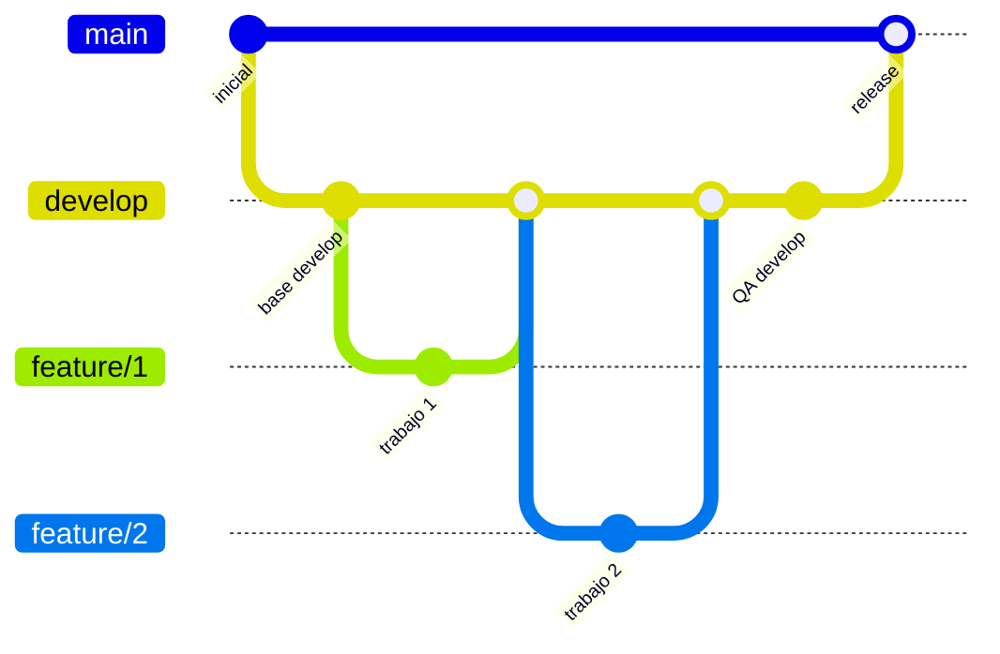

# Flujo Git — Samurai (admin + client)

Este documento define cómo trabajamos con ramas en **samurai-admin** y **samurai-client**. Aplica a ambos repos por igual.

## Ramas permanentes

| Rama | Propósito |
|------|-----------|
| `main` | Producción. Solo recibe cambios probados y estables. |
| `develop` | Integración y pruebas. Aquí se juntan las features antes de liberar. |

Nunca commitear directamente en `main` ni en `develop` salvo hotfixes acordados o merges desde el flujo descrito abajo.

## Ramas de trabajo (features)

Cada tarea o cambio va en su propia rama, creada **desde `develop` actualizada**:

```bash
git checkout develop
git pull origin develop
git checkout -b feature/nombre-corto
```

Convención de nombres:

- `feature/...` — funcionalidad nueva
- `fix/...` — corrección de bug
- `chore/...` — tooling, deps, CI, docs
- `refactor/...` — cambios internos sin cambio de comportamiento visible

Ejemplos: `feature/login-admin`, `fix/checkout-total`, `chore/eslint-config`.

## Flujo cuando hay varias ramas (ej.: 4 features)

1. **Desarrollar** en paralelo o en serie, cada una en su rama (`feature/a`, `feature/b`, …).
2. **Integrar en `develop`** cuando cada rama esté lista (PR o merge local + push):

   ```bash
   git checkout develop
   git pull origin develop
   git merge --no-ff feature/nombre   # conserva historial de la feature
   git push origin develop
   ```

   Repetir por cada rama terminada hasta que `develop` tenga todo lo del sprint/ciclo.

3. **Probar en `develop`**: build, tests, smoke manual, entorno de staging si existe. No pasar a `main` si algo falla.

4. **Liberar a `main`** solo cuando `develop` esté verde:

   ```bash
   git checkout main
   git pull origin main
   git merge --no-ff develop
   git push origin main
   ```

5. **Sincronizar** (opcional pero recomendado): merge de `main` a `develop` si hubo hotfix solo en `main`.



## Pull requests (recomendado)

- Abrir PR de `feature/*` → `develop` (revisión + CI).
- Abrir PR de `develop` → `main` cuando corresponda el release (checklist de QA completo).

## Commits

- Mensajes claros en imperativo o descriptivo: `feat: panel de pedidos`, `fix: validación de stock`.
- Commits pequeños y atómicos dentro de la rama feature.

## Repos

| Repo | Remoto |
|------|--------|
| Admin | https://github.com/Matias-Hernandezz/samurai-admin.git |
| Client | https://github.com/Matias-Hernandezz/samurai-client.git |

Mismo flujo en los dos; no mezclar código admin/client en un solo repo.

## Comandos rápidos al clonar

```bash
git clone <url>
cd <repo>
git fetch origin
git checkout develop    # trabajo diario desde aquí
git pull origin develop
```

## Hotfix en producción (excepción)

Si hay urgencia en `main`:

```bash
git checkout main
git pull origin main
git checkout -b hotfix/descripcion
# fix, commit, merge a main Y a develop
```

Tras merge a `main`, **siempre** llevar el mismo fix a `develop` para no diverger.
